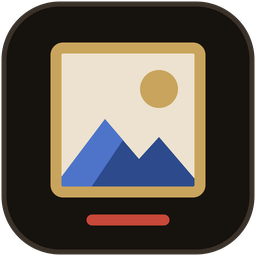

<div align="center">



# PngWebp

> Convierte imágenes **PNG y JPG a WebP** con la máxima calidad y el menor peso: sueltas tus imágenes o una carpeta entera y obtienes archivos mucho más livianos, sin elegir calidades ni tocar nada.

[](CHANGELOG.md)
[](https://github.com/MiguelBigott/pngwebp/actions/workflows/ci.yml)
[](https://go.dev)
[](#-instalación)
[](LICENSE)
[](https://developers.google.com/speed/webp)
[](https://github.com/MiguelBigott/codex)

[Historial de versiones](CHANGELOG.md) · [Releases](../../releases) · [Descargar el instalador](../../releases/latest)


<sub>Panel de actividad generado a diario por <a href=".github/workflows/estadisticas.yml">GitHub Actions</a>, sin servicios de terceros.</sub>

</div>

---

## 📖 Índice

- [Funciones](#-funciones)
- [Cómo decide la calidad](#-cómo-decide-la-calidad)
- [Stack](#-stack)
- [Instalación](#-instalación)
- [Compilar](#️-compilar)
- [Seguridad y privacidad](#-seguridad-y-privacidad)
- [Licencia](#️-licencia)
- [Créditos](#️-créditos)

## ✨ Funciones

- **Suelta y listo**: arrastra imágenes o carpetas enteras (con sus subcarpetas) a la ventana, o elígelas desde el PC. Cada una se convierte al instante.
- **Máxima calidad, menor peso**: sin controles de calidad; la app elige sola la mejor forma de comprimir cada imagen ([ver cómo](#-cómo-decide-la-calidad)).
- **Cuatro tamaños**: **original**, **1:1** (1000 × 1000), **16:9** (1920 × 1080, horizontal) y **9:16** (1080 × 1920, para el celular). Las proporciones encajan la imagen centrada y sin deformarla; el espacio que sobra queda transparente.
- **Fotos del celular derechas**: respeta la orientación que guarda la cámara, así que nada sale acostado.
- **Nada se pisa**: si ya existe `foto.webp`, guarda `foto (2).webp`; las proporciones se anotan en el nombre: `foto (9x16).webp`.
- **Cuentas claras**: cada imagen muestra cuánto pesaba, cuánto pesa, el ahorro, el modo y sus medidas, y abajo el total ahorrado.
- **Archivos dañados**: si una imagen está cortada o no es un PNG o JPG de verdad, lo avisa en lugar de convertirla a medias.
- **Ventana propia**: ventana nativa de Windows (WebView2) con su icono nítido en la barra de tareas.
- **Parte de [Codex](https://github.com/MiguelBigott/codex)**: el launcher de la suite la instala, la actualiza y la abre.
- **En tu idioma**: usa el idioma elegido en [Codex](https://github.com/MiguelBigott/codex) (8 idiomas) o, sin Codex, el del PC.

## 🎯 Cómo decide la calidad

| Imagen | Qué hace | Resultado en las pruebas |
|---|---|---|
| **JPG** (fotos) | WebP con pérdida a calidad 92, con `-sharp_yuv` y el método más cuidadoso (`-m 6`) | Foto de 1920 × 1200: 529 KB → 156 KB (**−71 %**), diferencia invisible (PSNR 44 dB) |
| **PNG** de capturas, logos y gráficos | Prueba sin pérdida y con pérdida; gana **sin pérdida** y lo recomprime al máximo (`-z 9`) | Captura: 124 KB → 54 KB (**−56 %**), **idéntica píxel a píxel** |
| **PNG** de fotos | Gana **con pérdida** a calidad 92: sin pérdida pesaría 6 veces más | Foto en PNG: 1,4 MB → 156 KB (**−89 %**) |

Un PNG sale sin pérdida si así pesa como mucho un 20 % más que con pérdida. Se conserva el perfil de color (ICC) y se descarta el resto de los metadatos, como la ubicación GPS de las fotos.

## 🧱 Stack

| Capa | Tecnología |
|---|---|
| Aplicación | [Go](https://go.dev): servidor local con la biblioteca estándar y [x/image](https://pkg.go.dev/golang.org/x/image) para encuadrar |
| Motor | [libwebp](https://developers.google.com/speed/webp) 1.6.0 de Google (`cwebp`) |
| Ventana | [WebView2](https://developer.microsoft.com/microsoft-edge/webview2/) con [go-webview2](https://github.com/jchv/go-webview2) |
| Interfaz | HTML, CSS y JavaScript embebidos (`go:embed`), skin «Lámina» con Inter y Space Mono |
| Instalador | [NSIS](https://nsis.sourceforge.io) |
| CI | GitHub Actions |

## 📦 Instalación

Descarga `PngWebp-Setup-<versión>.exe` desde [Releases](../../releases/latest), o instálalo desde [Codex](https://github.com/MiguelBigott/codex).

- Se instala en `C:\Program Files\PngWebp` (desde Codex, en `C:\Program Files\Codex\PngWebp`) con el motor WebP en `componentes`.
- Las imágenes convertidas van por defecto a `Imágenes\PngWebp`; se puede cambiar desde la app.
- La configuración se guarda en `%LOCALAPPDATA%\PngWebp`.
- Al desinstalar se borran el programa, el motor y la configuración; **tus imágenes no se tocan**.

## 🛠️ Compilar

Requisitos: [Go](https://go.dev/dl), [NSIS](https://nsis.sourceforge.io) y go-winres
(`go install github.com/tc-hib/go-winres@latest`).

```powershell
.\build\compilar.ps1
```

Genera `dist/PngWebp.exe`, `dist/componentes/` y `dist/PngWebp-Setup-<versión>.exe`. La primera vez baja
libwebp de la [página oficial de Google](https://developers.google.com/speed/webp/download), verifica su
SHA-256 y guarda `cwebp.exe` con su licencia en `build/componentes/` (fuera de git).

El logo «Lámina» (una lámina de pergamino con sol de oro y montañas de tinta, en el estilo del logo de Codex) se define en `build/generar_logo.py`, que escribe `web/logo.svg`,
`build/logo.png`, `build/app.ico` (con una versión reforzada para 16-32 px) y `build/lateral.bmp`:

```powershell
python build\generar_logo.py
```

Para revisar la interfaz en un navegador, sin ventana, ejecuta la app con `PNGWEBP_SIN_VENTANA=1` y abre
`http://127.0.0.1:47831`.

## 🔐 Seguridad y privacidad

- **Todo ocurre en tu PC**: las imágenes no salen del equipo; la app no usa internet.
- El servidor de la app escucha **solo en `127.0.0.1`**: no es accesible desde otros equipos.
- La API rechaza peticiones con un origen distinto al de la propia app y las acciones exigen una cabecera propia, así que una página web abierta en el navegador no puede usarla.
- Cada imagen se reconoce por su contenido, no por la extensión, y tiene un tope de 300 MB.
- El motor se baja al compilar **solo desde Google**: el archivo está firmado con la clave de publicación de WebP (`6B0E 6B70 976D E303 EDF2 F601 F9C3 D6BD B823 2B5D`) y el script verifica su SHA-256.

## ⚖️ Licencia

**Creado por [Miguel Bigott](https://github.com/MiguelBigott)** y publicado con licencia [MIT](LICENSE): cualquiera puede usarlo, copiarlo, modificarlo y compartirlo libremente, también en sus propios proyectos, siempre que mantenga el aviso de autor. Se entrega tal cual, sin garantías.

El motor WebP de Google conserva su licencia BSD (en `componentes/LICENSE-libwebp.txt`), y lo que va dentro de PngWebp.exe (Go, go-webview2, golang.org/x/image y las tipografías) está en `LICENCIAS-TERCEROS.txt`, junto a la app.

## 🖋️ Créditos

**Creado por Miguel Bigott.** Nació de un conversor en HTML que dejaba todo en 1000 × 1000.

Incluye [libwebp](https://chromium.googlesource.com/webm/libwebp) de Google (licencia BSD, en `componentes/LICENSE-libwebp.txt`) y las tipografías [Inter](https://fonts.google.com/specimen/Inter) y [Space Mono](https://fonts.google.com/specimen/Space+Mono) (SIL Open Font License, ver `web/fonts/`).
